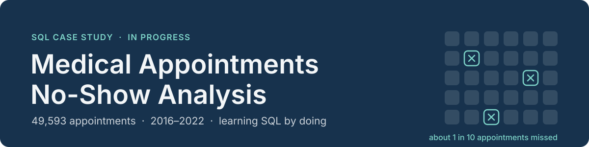
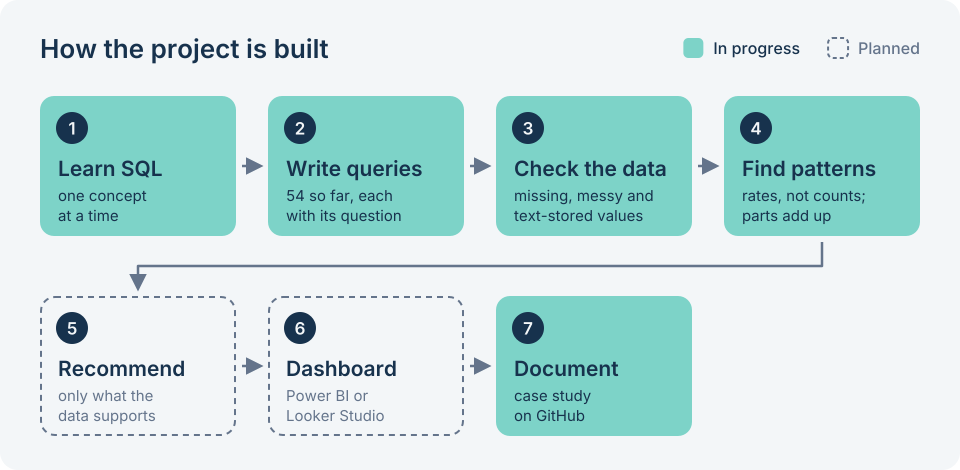

<p align="center">
  
</p>

<p align="center">
  
  
  
  
  
</p>

**A hands-on SQL case study of missed appointments at a public rehabilitation clinic in southern Brazil.**

I'm learning SQL by answering real business questions on 49,593 appointment records, so this repository grows as my skills do. I'm learning with an AI tutor, and the [SQL progress](#sql-progress) table shows honestly what I can already write on my own. Every number below comes from a query I ran in DB Browser for SQLite (saved in [`sql/project01.sql`](sql/project01.sql)), or from simple arithmetic on those results.

<table>
  <tr><td><b>The question</b></td><td>Which appointments get missed, and what can the data honestly tell a clinic about why?</td></tr>
  <tr><td><b>The data</b></td><td>49,593 appointments · 26 columns · 20 Jun 2016 – 25 Feb 2022</td></tr>
  <tr><td><b>Tools</b></td><td>SQL (SQLite) in DB Browser for SQLite · Git and GitHub</td></tr>
  <tr><td><b>Status</b></td><td>Exploration and data-quality checks in progress · 54 queries so far</td></tr>
  <tr><td><b>Headline so far</b></td><td>Among full years, the no-show rate nearly doubled: about 8% in 2017–18 → 15.1% in 2021 <i>(preliminary, still being checked)</i></td></tr>
</table>

---

## Contents

[Overview](#overview) · [Business questions](#business-questions) · [Dataset](#dataset) · [Tools](#tools) · [SQL progress](#sql-progress) · [Repository](#repository-structure) · [Findings](#findings-so-far) · [Recommendations](#recommendations) · [Roadmap](#roadmap) · [What I'm learning](#what-im-learning) · [Author](#author)

---

## Overview

**What this project investigates.** Patterns in missed appointments ("no-shows"): how often they happen, how that changed over time, and whether they differ by specialty, timing, age, gender, city or weather.

**Why it matters.** A missed appointment is a slot that another patient could have used. For a clinic in a public health system, understanding *who* misses appointments and *when* is the first step towards reducing them.

**The business problem.** About 1 in 10 appointments in this data is missed. Before anyone can act on that, they need to know whether the pattern is real, how big it is, and how much the data's gaps limit what we can say.

**What I want to learn and show.** Writing SQL from the basics up to window functions, checking data quality before trusting a result, turning numbers into plain business meaning, and documenting my work so someone else can follow it.

<p align="center">
  
</p>

**How each question is answered:** I write the business question as a comment, write the query, run it, then **self-check** that the parts add back up to the total (for example, no-shows by year must add up to 4,832). Anything odd goes into the data-quality notes.

---

## Business questions

These are the questions I'm **investigating**. A status here doesn't mean the answer is final.

| # | Question | Status |
|:-:|---|---|
| 1 | What share of appointments are missed? | 🟢 First answer |
| 2 | How has the no-show rate changed over time? | 🟢 First answer, being checked |
| 3 | Which specialties receive the most appointments? | 🟢 First answer |
| 4 | Do no-show rates differ by specialty? | 🟡 Started |
| 5 | Does appointment timing (shift, time of day) influence no-shows? | 🟡 Shift only so far |
| 6 | Are there differences across age groups? | 🟡 Started, needs a re-check |
| 7 | Do gender, city or weather relate to no-shows? | 🟡 First look done |
| 8 | What data-quality problems exist, and how do they limit the answers? | 🟡 In progress |
| 9 | What reasons are recorded for missed appointments? | 🟡 Started |

🟢 first answer from a query · 🟡 started · ⚪ not started

---

## Dataset

**Source:** [Medical Appointments No-Show](https://doi.org/10.17632/wm6w2fvkfj.1), Luiz Henrique Salazar, Mendeley Data, version 1 (2023). Licence: CC BY 4.0.
**From the dataset page:** records from the Center of Specialization in Physical and Intellectual Rehabilitation (CER) at the University of Vale do Itajaí, an outpatient rehabilitation clinic serving Brazil's public health system, combined with ICD codes and weather data.

- **49,593 rows** (one row = one appointment) · **26 columns** · one table, `appointments`
- Stored in a SQLite database and queried in DB Browser for SQLite
- The data file itself isn't stored in this repository. Download it from the link above.

<details>
<summary><b>All 26 columns: what they hold and what I've checked</b></summary>
<br>

Meanings marked *(from the name)* are my reading of the column name and haven't been checked yet.

| Column | What it holds | My checks so far |
|---|---|---|
| `appointment_date` | Date of the appointment | Stored as text `DD/MM/YYYY`, so it sorts wrongly until rebuilt as `YYYY-MM-DD` |
| `appointment_time` | Time of the appointment *(from the name)* | Not explored yet |
| `appointment_month` | Month | Stored as names (e.g. `sept`), which sort alphabetically |
| `appointment_year` | Year | 2016–2022; 2016 and 2022 are partial years |
| `appointment_shift` | `morning` / `afternoon` | Checked |
| `specialty` | Therapy area | 7,454 empty; values partly in Portuguese |
| `no_show` | `yes` = missed, `no` = attended | Lowercase only; 4,832 `yes` |
| `no_show_reason` | Reason recorded for a missed appointment | Free text in Portuguese, with many different spellings |
| `gender` | `M` / `F` / `I` | 7 rows are `I` |
| `age` | Age | Stored as text (e.g. `68.0`); 10,350 empty; 84 above 100 |
| `date_of_birth` | Date of birth *(from the name)* | Not explored yet |
| `under_12_years_old` | Age flag *(from the name)* | Not explored yet |
| `over_60_years_old` | Age flag *(from the name)* | Not explored yet |
| `disability` | Disability information *(from the name)* | Not explored yet |
| `patient_needs_companion` | Whether a companion is needed *(from the name)* | Not explored yet |
| `city` | City | 13 cities; 5,181 empty |
| `entry_service_date` | Date of entry into the service *(from the name)* | Not explored yet |
| `icd` | ICD code (per the dataset page) | Not explored yet |
| `average_temp_day` | Average temperature that day | Values from 8.94 to 28.01 |
| `max_temp_day` | Highest temperature that day *(from the name)* | Not explored yet |
| `average_rain_day` | Average rainfall that day *(from the name)* | Not explored yet |
| `max_rain_day` | Highest rainfall that day *(from the name)* | Not explored yet |
| `rainy_day_before` | Rain on the previous day *(from the name)* | Not explored yet |
| `storm_day_before` | Storm on the previous day *(from the name)* | Not explored yet |
| `rain_intensity` | Rain category *(from the name)* | Not explored yet |
| `heat_intensity` | Heat category *(from the name)* | Not explored yet |

</details>

**Limitations I keep in mind**

- **No patient ID.** Every count is a count of *appointments*, not patients.
- **Missing values.** No specialty: 7,454 · no age: 10,350 · no city: 5,181. Only 34,723 rows (70%) have both a specialty and an age.
- **Numbers and dates stored as text.** These need `CAST` and rebuilding before they behave.
- **Free-text reasons** in Portuguese, with many spellings.
- **Partial years.** 2016 starts on 20 June and 2022 ends on 25 February; 2020 has only 904 appointments.
- **No cost or revenue data**, so financial impact can't be measured from this dataset.

---

## Tools

| Tool | How I use it | Status |
|---|---|---|
| **SQL (SQLite)** | All analysis so far | ✅ In use |
| **DB Browser for SQLite** | Writing and running queries | ✅ In use |
| **Git and GitHub** | Version history of my queries and write-up | ✅ Started Nov 2026 |
| **Power BI or Looker Studio** | Dashboard (Power BI Desktop doesn't run on macOS, so the tool is still to be decided) | ⏳ Planned |

---

## SQL progress

A query existing in [`sql/project01.sql`](sql/project01.sql) doesn't mean I can write it alone, because some were written with guidance. So I log every attempt and mark a concept ✅ only after I've passed a **solo test**: writing a correct query with no help, no notes and no example of the same task. One solo pass isn't mastery; it means I've done it on my own at least once.

| Concept | Where it shows up in this project | Status |
|---|---|:-:|
| `SELECT`, `FROM`, aliases (`AS`) | Every query | ✅ |
| `DISTINCT` | Listing cities, reasons, specialties | ✅ |
| `WHERE` (text values are case-sensitive) | `'yes'` works, `'YES'` returns nothing | ✅ |
| `ORDER BY`, `LIMIT` | Biggest groups first; first 5 rows | ✅ |
| `COUNT(*)`, `GROUP BY` | Appointments per specialty, year, shift, gender | ✅ |
| `HAVING` | Specialties with more than 500 no-shows | ✅ |
| `AVG`, `MIN`, `MAX` | Lowest, highest and average temperature | ✅ |
| `CAST` (numbers stored as text) | Counting ages above 100 | ✅ |
| `CASE WHEN`, grouped by its label | Hot vs not-hot days | ✅ |
| `IS NULL` | Appointments with no specialty | ✅ |
| `AND`, `OR` | Missing specialty *and* / *or* age | ✅ |
| `IN`, `LIKE`, `BETWEEN` | Free-text reasons; ages 60–100 | ✅ |
| `substr` | Cutting the day out of a text date | ✅ |
| `\|\|` (joining text) | Joining shift and no-show status | ✅ |
| `IS NOT NULL` | Rows with both specialty and age (fixed after a hint) | 🔄 |
| Rates: `SUM(CASE …) * 100.0 / COUNT(*)` | No-show rate by year, gender, city, age group | 🔄 |
| Rebuilding text dates as `YYYY-MM-DD` | Finding the first and last dates | 🔄 |
| `GROUP BY` on two columns | Year × specialty check | ⬜ |
| `COALESCE`, `TRIM`, `LOWER`, `REPLACE` | Cleaning text values | ⬜ |
| Finding duplicates | Data-quality checks | ⬜ |
| `JOIN`s | After building small lookup tables | ⬜ |
| Subqueries and CTEs | Multi-step questions | ⬜ |
| Window functions | Rankings and running totals | ⬜ |

✅ passed a solo test · 🔄 practised with guidance (no solo pass yet) · ⬜ planned

**Honest note:** rates are the core calculation in this project, and I haven't passed a solo test on them yet. My one solo attempt gave a wrong answer, and the rate queries in the file were written with guidance. That's my next learning goal.

<details>
<summary><b>Example 1: the no-show rate per year</b></summary>
<br>

```sql
-- Appointments and no-show rate (%) for each year, oldest first.
SELECT appointment_year,
       COUNT(*) AS appointments,
       SUM(CASE WHEN no_show = 'yes' THEN 1 ELSE 0 END) * 100.0 / COUNT(*) AS no_show_rate
FROM appointments
GROUP BY appointment_year
ORDER BY appointment_year ASC;
```

- `SUM(CASE WHEN no_show = 'yes' THEN 1 ELSE 0 END)` counts the no-shows.
- `* 100.0` turns the answer into a percentage. Writing `100` instead of `100.0` makes SQLite drop the decimals.
- `/ COUNT(*)` divides by all appointments in that year.

</details>

<details>
<summary><b>Example 2: fixing dates stored as text</b></summary>
<br>

Sorting the raw `DD/MM/YYYY` text put **31/10/2019** at the top as the "latest" date, because SQL compared the day first. Rebuilding each date as `YYYY-MM-DD` fixed the order and showed where the data really ends:

```sql
-- The 5 latest different dates, newest first.
SELECT DISTINCT
       substr(appointment_date, 7, 4) || '-' ||
       substr(appointment_date, 4, 2) || '-' ||
       substr(appointment_date, 1, 2) AS sortable_date
FROM appointments
ORDER BY sortable_date DESC
LIMIT 5;
-- Latest date: 2022-02-25. Earliest date (same query, ASC): 2016-06-20.
```

</details>

---

## Repository structure

```
medical-appointments-no-show-analysis/
├── README.md            ← this page
├── assets/
│   ├── banner.svg       ← header image
│   └── workflow.svg     ← project workflow diagram
└── sql/
    └── project01.sql    ← all my queries so far, each with its question as a comment
```

---

## Findings so far

> **Preliminary.** These are early results from a project in progress, not final conclusions. They describe patterns in the data and don't prove causes.

**How I checked them:** every figure comes from a query in [`sql/project01.sql`](sql/project01.sql), or from simple arithmetic on its result. Five separate breakdowns (by year, city, gender, age group and shift) each add back up to exactly 49,593 appointments and 4,832 no-shows.

### What my queries show so far

**1. About 1 in 10 appointments is missed:** 4,832 of 49,593 (9.7%).

**2. The no-show rate rose over time.**

| Year | Appointments | No-show rate | Note |
|:-:|--:|--:|---|
| 2016 | 7,985 | 4.0% | Partial year (from 20 Jun) |
| 2017 | 12,564 | 8.3% | |
| 2018 | 9,606 | 8.0% | |
| 2019 | 8,584 | 12.3% | |
| 2020 | 904 | 13.9% | Very few appointments |
| 2021 | 9,008 | 15.1% | |
| 2022 | 942 | 17.2% | Partial year (to 25 Feb) |

Using only full years with enough appointments, the rate **nearly doubled**, from about 8% (2017–18) to 15.1% (2021). I first described this as "4 times higher than 2016", until I found that 2016 covers only half a year. I haven't yet checked whether a change in the mix of specialties explains the rise.

**3. Shift makes little difference:** afternoon 9.9% (2,762 of 27,865) vs morning 9.5% (2,070 of 21,728).

**4. Gender shows a small gap:** female patients 10.3% vs male patients 9.6%. This compares all female and male patients of every age, not only adults.

**5. Hot days show no clear difference:** 10.0% on days with an average temperature of 25 or more vs 9.7% on other days. Hot days are a small group, so this comparison is weak.

**6. Large cities are similar:** every city with more than 2,000 appointments sits between 7.4% and 10.5%.

**7. Appointments with missing details are missed more often:** no city recorded 15.1%, no age recorded 12.9%, against 9.7% overall.

### Data-quality observations

- **Specialty** is empty for 7,454 appointments, plus 57 marked `sem especialidade` ("no specialty").
- **Age** is empty for 10,350 appointments (21%), and 84 ages are above 100 (up to 110), which is likely an error.
- **City** is empty for 5,181 appointments (10%).
- **Text-stored values give wrong answers until fixed.** `MIN`/`MAX` on the text age returned 10 and 91 instead of 2 and 110. Sorting raw dates put 31/10/2019 as the latest date.
- **Month names** (`sept`, `apr`, …) sort alphabetically, not in calendar order.
- **No-show reasons** are free text in Portuguese:
  - Exact matching undercounts. "doente" (sick) is 197 with an exact match vs 257 with `LIKE '%doente%'`, and "transporte" is 191 vs 205.
  - Many no-shows seem to have no reason recorded at all. I still need a dedicated query to count them.
  - Some entries describe clinic-side cancellations, not patients missing appointments.
- **Partial years:** the data runs from 20 Jun 2016 to 25 Feb 2022.

### Still under investigation

- Does the rise over time hold **within each specialty**, or did the mix of specialties change? *(year × specialty)*
- **Why** are appointments with missing details missed more often?
- Do **specialty** no-show rates differ meaningfully?
- **Age groups:** no age recorded 12.9%, 60 and over 10.0%, under 60 8.8%. The "60 and over" group includes the 84 ages above 100, so it needs recalculating without them before I compare age groups.
- How many no-shows have **no reason** recorded?
- Do **time of day**, **rain** or **storms the day before** relate to no-shows?

---

## Recommendations

**⏳ Pending.** I'll add recommendations only once the analysis supports them. Each one will name the finding behind it, how large the effect is, and what the data can't tell us.

---

## Roadmap

| Stage | What it covers | Status |
|:-:|---|:-:|
| 1 | Explore the data: structure, values, gaps | ✅ Mostly done |
| 2 | Basic queries: `SELECT`, `WHERE`, `ORDER BY`, `LIMIT` | ✅ Done |
| 3 | Counting and grouping: `COUNT`, `GROUP BY`, `HAVING` | ✅ Done |
| 4 | Data quality: missing values, text-stored data, free text | 🔄 In progress |
| 5 | `JOIN`s, subqueries and CTEs | ⬜ Next |
| 6 | Window functions | ⬜ Planned |
| 7 | Findings and recommendations | ⬜ Planned |
| 8 | Dashboard | ⬜ Planned |
| 9 | Final write-up | 🔄 Started (this page) |

---

## What I'm learning

- **Check how data is stored before trusting a result.** Text-stored ages and dates gave confident but wrong answers.
- **Compare rates, not counts.** A bigger group always has more no-shows; the rate shows whether it's really different.
- **Check the date range before comparing years.** Finding the partial years changed my headline from "4 times higher" to "nearly doubled".
- **Self-check every breakdown.** The parts must add back up to the total.
- **Free text needs `LIKE`**, and even then it undercounts.
- **Missing data can carry a signal.** It isn't always safe to drop the blanks.
- **Write the question first.** Every query in my SQL file starts with the business question it answers.

---

## Author

**Nandini Bhati**: aspiring Business and Product Analyst · BBA (FinTech), CHRIST University<br>
[GitHub](https://github.com/NandiniB216) · [LinkedIn](https://linkedin.com/in/nandini-bhati)

<sub>**How this project is made:** I'm learning SQL through hands-on project work with AI assistance (Claude as a tutor). I run every query myself in DB Browser for SQLite. Some queries were written with guidance, and the SQL progress table separates those from the ones I've written on my own. A few lines in the SQL file were corrected after an AI review in November 2026. This README and its images were drafted with AI help and checked against my own query results.</sub>
